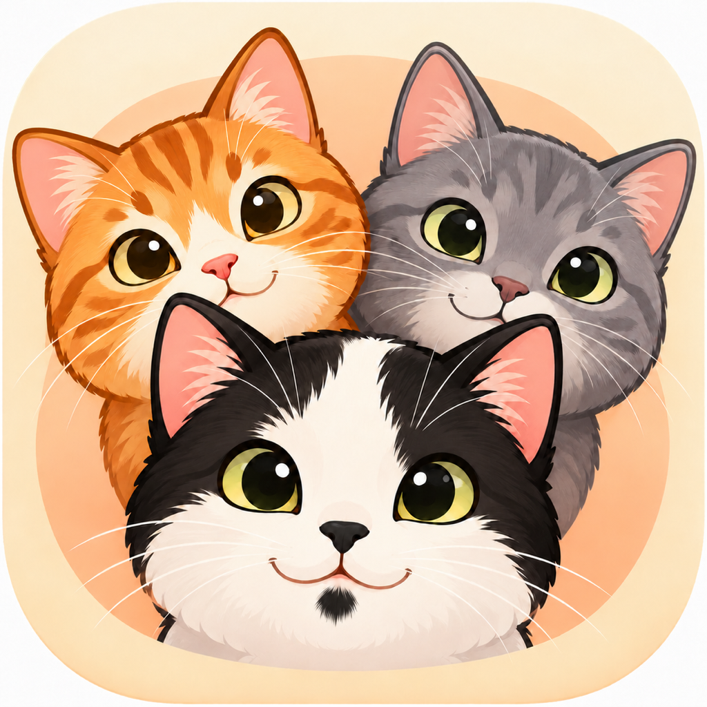
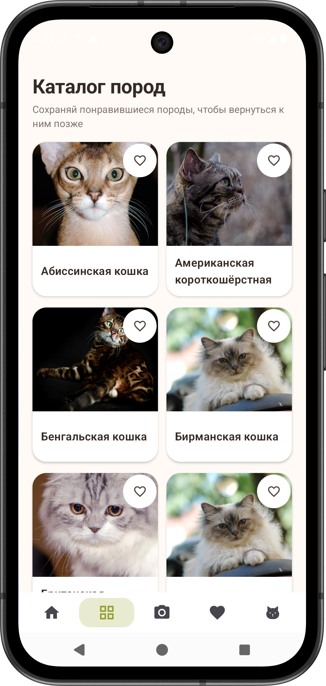
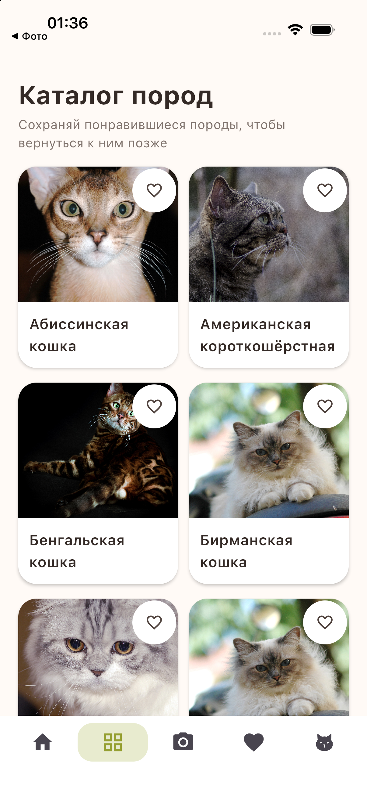
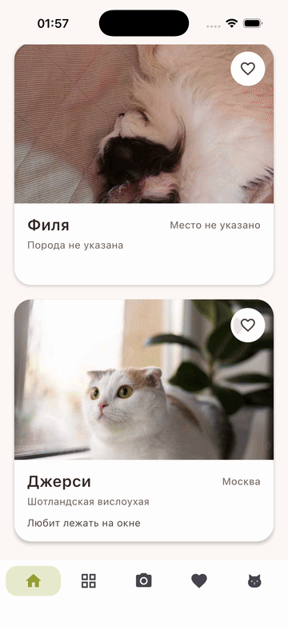

# Catlas

  

Catlas — кроссплатформенное приложение-каталог пород и лента фотографий котиков для Android и iOS. Каталог пород и URL фотографий загружаются из Supabase через Ktor, пользовательские избранные сохраняются локально.

## Результат

### Скриншоты

<table>
  <tr>
    <th align="center">Android — Pixel 9a</th>
    <th align="center">iOS — iPhone 17 Pro</th>
  </tr>
  <tr>
    <td align="center"></td>
    <td align="center"></td>
  </tr>
</table>

### Видео

<table>
  <tr>
    <th align="center">Android — 00:14–00:19</th>
    <th align="center">iOS — 00:58–01:03</th>
  </tr>
  <tr>
    <td align="center"></td>
    <td align="center"></td>
  </tr>
</table>

Полные записи: [Android](docs/media/videos/android.mp4) · [iOS — iPhone](docs/media/videos/ios-iphone.mp4).

## Какие технологии использовались

1. Kotlin Multiplatform и Compose Multiplatform для использования общих кода и интерфейса для Android и iOS.
2. Ktor Client и Supabase(BaaS) для сетевых запросов.
3. Kotlin Serialization для преобразования JSON-ответов сервера в объекты приложения.
4. Room для локального хранения данных.
5. Koin для внедрения зависимостей.
6. Coil для загрузки и отображения изображений.

## Структура модулей

- `:androidApp` — Android-точка входа с одной Activity.
- `:shared` — общий Compose UI-контейнер приложения, навигация и сборка Koin-модулей.
- `:core` — доменные модели и контракты, реализации репозиториев, Supabase/Ktor, Room, общие UI-компоненты и ресурсы.
- `:feature:home-feed` — лента котиков и детали кота.
- `:feature:catalog` — каталог пород и детали породы.
- `:feature:favorites` — избранные котики и породы.
- `:feature:profile` — профиль пользователя.
- `:feature:camera` — добавление публикации с фотографией.

Фичи зависят от `:core`; `:core` не зависит от фич. Модуль `:shared` подключает их и содержит навигацию приложения. Общий Kotlin и Compose-код находится в `commonMain`, платформенные фабрики базы — в соответствующих source sets.
